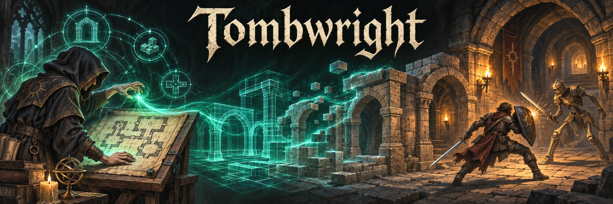

# Tombwright



Build, prove, and challenge killer dungeons. The successor to *Gloamhollow* (SilverDay Media).

Status: **M0, engine split.** The deterministic sim core exists in JS and PHP with shared golden vectors. The game rules are being ported from Gloamhollow.

- Design spec: [`docs/spec.md`](docs/spec.md) · decisions: [`docs/decisions.md`](docs/decisions.md) · sim rules: [`docs/sim-rules.md`](docs/sim-rules.md)
- Server database setup: [`docs/server-setup.md`](docs/server-setup.md)

## Requirements

PHP 8.3 (mbstring, pdo_mysql, zlib), MariaDB 10.11, Node 22 (tests and tooling only; the game needs no build step), Composer 2.

## Develop

```bash
composer install
npm install
npm test
vendor/bin/phpunit
npm run e2e        # Gloamhollow walkthrough in headless Chromium
```

Database tests need `TW_DB_*` settings (see `config/local.env.example`). In Claude Code cloud sessions the SessionStart hook sets everything up; `scripts/cloud-setup.sh` is the matching environment setup script.

## Licence

MIT, see `LICENSE`. Third-party notices: `LICENSES/`.
